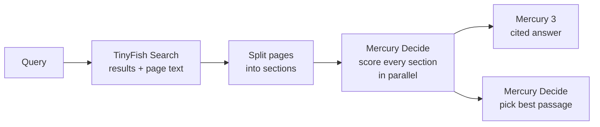

# Mercury × TinyFish

**Ask a question, get a cited answer from the live web in a few seconds.**

This is an open-source demo of [TinyFish](https://tinyfish.ai) and [Inception](https://www.inceptionlabs.ai)'s
Mercury models working together:

- **TinyFish Search** finds results on the live web and reads each page.
- **[Mercury Decide](https://docs.inceptionlabs.ai/capabilities/decisions)** scores every section of every page for
  relevance and picks the single best passage.
- **[Mercury 3](https://www.inceptionlabs.ai/blog/introducing-mercury-3)**, a diffusion LLM, writes a short answer
  from the top sections, with citations. You watch it denoise into place.

Each step streams to the page as soon as it finishes, with its timing.

## How it works



1. **Search.** One TinyFish Search call returns the results and, with "Read pages deeply" on, each page's text as
   markdown.
2. **Split.** Each page is cut into sections at its headings (`lib/server/sections.ts`). The search snippet is
   always a candidate too.
3. **Rank.** Mercury Decide answers one yes/no question per section: *does this section help answer the query?*
   It returns a probability, not just a label. Sections are sent in small requests that all run at once, so
   long pages don't hold everything up.
4. **Answer and pick.** Mercury 3 writes the answer from the 8 most relevant sections and cites them as `[n]`.
   Alongside it, one Mercury Decide `choice` question picks the single best passage from the top 10.

If ranking is unavailable, Mercury 3 still answers from the search snippets.

## Why these models

- **Mercury Decide** is built for high-volume classification. It returns calibrated probabilities, bills input
  tokens only, and answers many questions about the same context in one request, so ranking dozens of sections is
  fast and cheap.
- **Mercury 3** generates the whole answer in parallel by diffusion rather than one token at a time. Writing the
  answer is the shortest step in the pipeline.

Example runs from development (times vary with the query and the pages found):

| Query | TinyFish Search | Mercury Decide | Mercury 3 | Total |
| --- | --- | --- | --- | --- |
| how long is the Golden Gate Bridge | 4.7 s | 1.0 s (9 calls) | 0.8 s | 6.5 s |
| FedEx One Rate medium box price | 3.1 s | 0.9 s (11 calls) | 0.6 s | 4.5 s |

## Run it

You need Node 24, a [TinyFish API key](https://agent.tinyfish.ai) and an
[Inception API key](https://platform.inceptionlabs.ai).

```sh
cp .env.example .env.local   # add TINYFISH_API_KEY and INCEPTION_API_KEY
npm install
npm run dev                  # http://localhost:3000
```

### Configuration

| Variable | Default | |
| --- | --- | --- |
| `TINYFISH_API_KEY` | | Required. TinyFish Search. |
| `INCEPTION_API_KEY` | | Required. Mercury Decide and Mercury 3. |
| `DECIDE_MODEL` | `mercury-decide` | |
| `ANSWER_MODEL` | `mercury-3` | |
| `ANSWER_REASONING_EFFORT` | `instant` | `instant`, `low`, `medium` or `high`. |
| `TINYFISH_SEARCH_URL` | `https://api.search.tinyfish.ai` | |
| `INCEPTION_BASE_URL` | `https://api.inceptionlabs.ai/v1` | |

## Code

| Path | What it does |
| --- | --- |
| `lib/server/pipeline.ts` | The whole search, start to finish. |
| `lib/server/relevance.ts` | Section scoring and best-passage pick with Mercury Decide. |
| `lib/server/sections.ts` | Splits a page's markdown into sections. |
| `lib/server/inception.ts` | Mercury Decide and Mercury 3 API calls. |
| `app/api/search/route.ts` | Streams each step to the browser as newline-delimited JSON. |
| `components/search-view.tsx` | The search form, answer and results. |

## License

[MIT](LICENSE)
